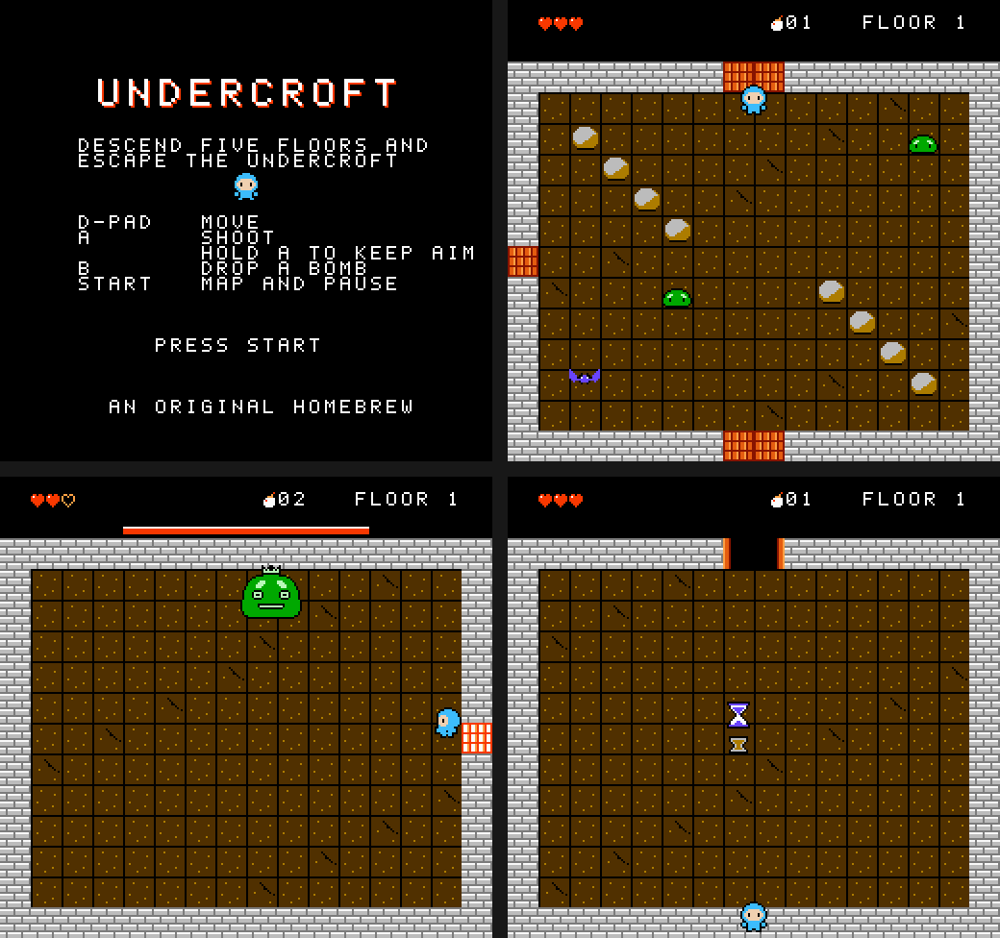

# Undercroft

An original top-down roguelite dungeon crawler for the NES, built for the cheap
"Sup / 400-in-1" style handhelds (the white Game Boy-shaped ones given away as
promo items). You clear rooms of monsters, find items that stack upgrades,
beat a boss on each floor and drop through a trapdoor to the next one.
Five floors, then you escape.



## Why this is an original game and not The Binding of Isaac

- **It can't run on this hardware.** These handhelds contain an NES-on-a-chip:
  a 6502 CPU at about 1.8 MHz, 2 KB of RAM and NES graphics (64 small sprites,
  4-colour tiles). The Binding of Isaac needs a modern PC, phone or console.
  No port or emulator closes that gap.
- **Its characters, art and name are someone else's copyright.** So this is a
  new game in the same genre, with an original hero (Wick), enemies, items and
  art. It doesn't copy that game's content.

## What's in the game

- Procedurally generated floors (7 to 15 rooms) with a start room, an item room
  and a boss room, plus a pause map.
- 12 room layouts with rocks and pits, randomly mirrored.
- 4 enemy types and a boss (the Gloop King) that hops and fires bullet rings.
  The boss gets stronger on each floor.
- 8 items: damage, fire rate, speed, range, extra heart, triple shot, piercing
  shots and +5 bombs.
- Bombs destroy rocks and hurt everything nearby, you included.
- Hearts and bombs drop from cleared rooms.
- Sound effects. There is no music yet.

### Controls

| Button | Action |
|---|---|
| D-pad | Move |
| A | Shoot. Your aim locks while A is held, so you can strafe. |
| B | Drop a bomb |
| Start | Map / pause |

The NES has one D-pad, so twin-stick aiming isn't possible. Holding A to lock
your aim is the substitute.

## Play it now (no hardware changes)

`dist/undercroft.nes` is a standard NES ROM (mapper 0, 32 KB PRG + 8 KB CHR).
It runs in any NES emulator: Mesen or FCEUX on PC, an NES emulator app on a
phone, or a cheap Linux handheld (copy the file to its SD card).

`dist/undercroft-web.html` is a single-file browser player with touch
controls. Open it in a browser; it loads the
[jsnes](https://github.com/bfirsh/jsnes) emulator from a CDN.

## Putting it on the handheld

This is the hard part, and it needs hardware work. The game runs from the
handheld's flash chip, so you have to remove that chip, back it up, build a new
flash image that includes this game, and program it back in. It needs
fine-pitch soldering and a chip programmer, and a mistake can kill the unit.
The full guide, with the risks and what is still unknown about your specific
unit, is in [docs/FLASHING.md](docs/FLASHING.md).

The ROM is built in the format that unit is known to run: mapper 0 with
CHR-ROM. Compatibility on your specific unit is **untested**.

## Building

Needs `cc65` (ca65, cc65, ld65) and Python 3.

```bash
sudo apt-get install cc65
```

```bash
make
```

The outputs are `build/undercroft.nes` and `build/undercroft-web.html`.
`make dist` copies both into `dist/`.

## Tests

The tests play the ROM headlessly in the [nes-py](https://pypi.org/project/nes-py/)
emulator. They drive the controller, read game RAM and take screenshots.

```bash
pip install nes-py pillow
```

```bash
python3 tests/smoke_test.py
```

```bash
python3 tests/extra_test.py
```

```bash
python3 tests/stress_test.py
```

The tests cover:

- **smoke_test:** title, floor generation, doors, combat, room clearing, bombs,
  the boss, items, the trapdoor to floor 2, the pause map and death.
- **extra_test:** 25 random floors, the item room, and winning on floor 5.
- **stress_test:** 8 enemies plus triple shot. It counts lag frames: frames
  where the game logic missed the 60 Hz budget.

## Project layout

| Path | What |
|---|---|
| `src/main.c` | Game logic (C, compiled with cc65) |
| `src/crt0.s` | Startup, NMI/vblank handler, controller, sprite helpers |
| `src/fast.s` | Hand-written assembly for the hot loops |
| `src/nrom.cfg` | Memory map (NROM-256) |
| `gfx/tiles.txt` | All graphics as ASCII art |
| `gfx/rooms.txt` | Room layouts |
| `tools/mkchr.py` | Converts the ASCII art into CHR-ROM |
| `tools/mkrooms.py` | Converts the layouts and checks every door is reachable |
| `tests/` | Emulator-driven tests |
| `web/player.html` | Browser player page (`make` embeds the ROM into it) |
| `docs/FLASHING.md` | Hardware guide |
